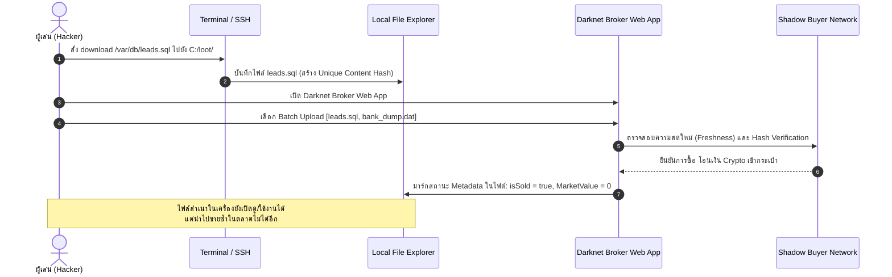
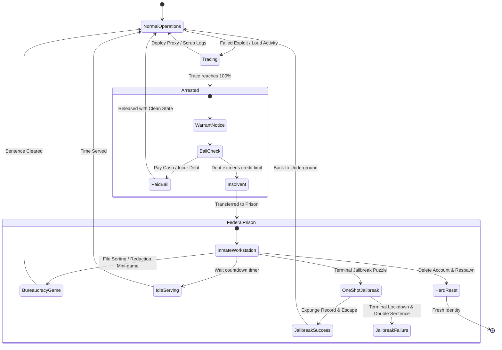
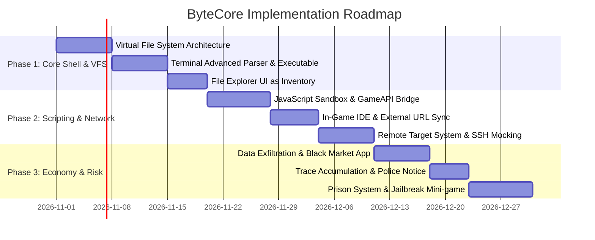

# Game Design Document (GDD): ByteCore / Xea OS
**Version:** 1.1.0  
**Status:** In Development / Architecture Ready  
**Target Platform:** Web (Desktop Browser) / Electron / Desktop Sim  
**Primary Engine / Tech Stack:** Modern JavaScript (ES Modules), Virtual DOM / Component System, CSS Glassmorphism Engine

---

## 1. Executive Summary & Vision

### 1.1 Game Concept
**ByteCore** คือเกมแนว **Immersive OS & Cyberpunk Hacker Simulation** ที่จำลองระบบปฏิบัติการเสมือน (**Xea OS**) ผู้เล่นจะสวมบทบาทเป็นแฮกเกอร์ใต้ดินที่เริ่มต้นจากเครื่องคอมพิวเตอร์ระดับเริ่มต้น สแกนเครือข่าย เจาะระบบผ่าน **Interactive Terminal**, ปลูกฝังมัลแวร์, ขโมยข้อมูลลับมาสะสมในเครื่องเพื่อนำไปฟอกขายในตลาดมืด (**Black Market**), และสามารถใช้ภาษา **JavaScript** จริงในการเขียน Script อัตโนมัติ ปรับแต่ง UI และสร้าง In-Game Application ของตัวเองได้อย่างอิสระ 

### 1.2 Core Pillars
1. **Realistic Hacker Authenticity:** ไหลลื่นด้วยระบบ CLI, SSH Remote, Script Execution และ Package Dependencies ที่ให้ความรู้สึกเหมือนแฮกเกอร์จริง ไม่ใช่แค่ Quick-Time Event (QTE)
2. **True Programmability (Turing Complete Gameplay):** ระบบ In-Game IDE & JavaScript Scripting Engine ที่สามารถเข้าถึงและสั่งการระบบจริงในเกม (DOM, Styling, APIs, Wallet, Hardware)
3. **Inventory as File System (VFS):** ระบบช่องเก็บของ (Inventory) รวมเป็นหนึ่งเดียวกับ Virtual File System (ไฟล์ `.exe`, `.dll`, `.js`, `.dat` คือทั้งไอเทม เครื่องมือ สกิล และสินค้า)
4. **High-Stakes Risk & Consequences:** ทุกการกระทำมีความร้อนสะสม (Heat / Trace Level) หากพลาดจนโดนจับ กฎหมายจะตามมา ทั้งค่าประกันตัว การล้มละลาย หรือการติดคุกจริงที่ต้องเผชิญกับมินิเกมเอกสาร หรือเดิมพันด้วย Jailbreak Hack ครั้งเดียวในชีวิต

---

## 2. Core Gameplay Loop

```mermaid
flowchart TD
    Scan["1. Recon & Scanning\n(scan, whois, nmap-like tool)"] --> Breach["2. Target Infiltration\n(SSH / Exploit .exe / Payloads)"]
    Breach --> Exfiltrate["3. Data Exfiltration & Persistence\n(Download .db / Plant Miner / Backdoor)"]
    Exfiltrate --> ManageFiles["4. File System & Inventory\n(Organize in File Explorer, inspect with .exe)"]
    ManageFiles --> Sell["5. Data Laundering / Broker\n(Batch Upload to Darknet Market for Crypto)"]
    ManageFiles --> Automation["6. Scripting & Tooling\n(Write JS Bots in IDE / Sync External Code)"]
    Sell --> Upgrade["7. Hardware & Tool Upgrade\n(Buy better CPU, RAM, Uplink, .dll modules)"]
    Upgrade --> Scan
    
    Exfiltrate -.->|Traced / Failed Countermeasure| Police["🚨 Police Raid & Heat Limit"]
    Police --> Bail{"Can Pay Bail?"}
    Bail -->|Yes| Debt["Wallet Deducted / Debt Incurred"]
    Debt --> Scan
    Bail -->|No (Bankrupt)| Prison["Federal Prison Sentence\n(Admin Work / Sentence Time / 1-Shot Jailbreak)"]
    Prison -->|Served / Escaped| Scan
    Prison -->|Wiped| Reset["Account Reset (New Identity)"]
```

---

## 3. Deep System Architecture

### 3.1 Terminal & Advanced Hacking System

Terminal ไม่ได้เป็นเพียงหน้าต่างพิมพ์คำสั่งสั้นๆ แต่ทำหน้าที่เป็น CLI เต็มรูปแบบ รองรับทั้งโหมด Local Shell, SSH Session, และ Tool Pipeline

#### 3.1.1 Command Pipeline & Syntax
* **Path & Execution Syntax:**
  ```bash
  # Local tool execution with dynamic help
  C:\Users\ByteCore> C:/tools/portscan.exe --help
  C:\Users\ByteCore> C:/tools/portscan.exe -t 192.168.1.45 -p 22,80,443

  # Remote SSH Connection
  C:\Users\ByteCore> ssh root@192.168.1.45 -p 22 -i id_rsa.key
  [root@target-node-45 ~]# ls -la /var/data/
  [root@target-node-45 ~]# download /var/data/customers.db C:/loot/customers.db
  ```
* **Tool Discovery (`--help` / `man`):** ทุกไฟล์ `.exe` หรือ Module เมื่อรันด้วย flag `--help` หรือ `help <path>` จะต้อง Parse ข้อมูล metadata ของไอเทมนั้นออกมา:
  * Description & Capabilities
  * Command Line Arguments
  * Hardware Requirements (e.g., ต้องการ CPU Lv.3 ขึ้นไป หรือ RAM 8GB)
  * Script API Hook (บอกว่าถ้าจะ import ใน JS Script ต้องเรียก method อะไร)

#### 3.1.2 Remote SSH & Session Management
* เมื่อเชื่อมต่อ SSH สำเร็จ Shell Prompt จะเปลี่ยนเป็น Session ของ Target เครื่องนั้น
* ผู้เล่นสามารถ:
  * สำรวจ Directory ของเป้าหมาย (`ls`, `cat`, `cd`, `grep`)
  * ดาวน์โหลดไฟล์ลับ (Data dumps, Private Keys, Password Hashes) ลงเครื่องตัวเองผ่านโปรโตคอล `download` หรือ `scp`
  * อัปโหลด Payload ขึ้นไปทิ้งไว้ (เช่น Background Miner, SSH Persistent Backdoor, Sniffer)

---

### 3.2 Virtual File Explorer (VFS) as Inventory & Equipment

ไฟล์ใน Xea OS ไม่ได้เป็นเพียง UI แต่คือ **Item Entity** ในระบบเกม

| นามสกุลไฟล์ | ประเภทในเกม (RPG Mapping) | หน้าที่ & ฟังก์ชันในเกม |
| :--- | :--- | :--- |
| **`.exe`** | **Active Tools (Active Skills)** | โปรแกรมรันเดี่ยว เช่น Scanner, Password Cracker, Exploit Kit, Wi-Fi Jammer สามารถรันผ่าน Terminal หรือดับเบิลคลิกเปิด UI พิเศษ |
| **`.dll` / `.mod`**| **Passive Upgrades (Equip/Plugins)**| ไดรเวอร์หรือโมดูลเสริม เช่น เพิ่มความเร็ว Brute-force 15%, ลดอัตรา Trace ลง 20% หรือเป็น Library สำหรับให้ JS เรียกใช้ |
| **`.js`** | **Player Automation Scripts** | โค้ดที่ผู้เล่นเขียนเองหรือซื้อมาเพื่อรันบอท ทำงานซ้ำซ้อน หรือสร้าง App ใหม่ใน OS |
| **`.dat` / `.sql` / `.db`**| **Loot & Exfiltrated Assets** | ข้อมูลที่ขโมยมาได้จากองค์กรหรือเหยื่อ เพื่อนำไป Upload ขายในตลาดมืด |
| **`.log` / `.txt`**| **Lore & Cryptic Clues** | เอกสารบันทึกเหตุการณ์ รหัสผ่าน ประวัติเป้าหมาย และปริศนา ARG |
| **`.css`** | **Theme / Skin Overrides** | ไฟล์ Style ที่ผู้เล่นสามารถนำมาเปลี่ยนธีม Glassmorphism, สี Neon, หรือจัด Layout Desktop |

#### การจัดการความจุ (Storage Capacity):
* ดิสก์มีความจุจำกัดตามระดับ HDD/NVMe ของ Rig ผู้เล่น
* หากพื้นที่เต็ม จะไม่สามารถ Download ข้อมูลหรือติดตั้ง Tool ใหม่ได้ บังคับให้ผู้เล่นต้องบริหาร Inventory (ลบไฟล์ขยะ, โอนถ่าย, หรือขายข้อมูลทิ้ง)

---

### 3.3 Core Scripting Engine (JavaScript Sandbox & Game Hooking)

หัวใจสำคัญที่มอบอิสระให้ผู้เล่น คือการนำ **Real JavaScript** มาเป็นส่วนหนึ่งของเกม โดยเปิดให้รันสคริปต์ที่ควบคุมสภาพแวดล้อมของเกมได้จริง

#### 3.3.1 In-Game IDE & Runtime
* **Built-in Code Editor Window (IDE):**
  * มี Line numbers, Syntax Highlighting พื้นฐาน, Run/Stop Button, และ Console Output
  * บันทึกไฟล์ลง Virtual File System ในโฟลเดอร์ `C:/Scripts/*.js`
* **External Synchronization & URL Fetch (แก้ปัญหา In-Game IDE พิมพ์ไม่สะดวก):**
  * เนื่องจากผู้เล่นระดับ Power User ชอบใช้ VS Code หรือ IDE จริงภายนอก ตัวเกมจึงมีระบบ:
    1. **`curl` / Web Fetch Command:**
       ```bash
       C:\Users\ByteCore> curl https://raw.githubusercontent.com/user/my-script/main/bot.js -o C:/Scripts/bot.js
       ```
    2. **Text/File Dropzone Dialog:** หน้าต่างสำหรับกด Paste โค้ดจาก Clipboard หรืออัปโหลดไฟล์ `.js` จากเครื่องจริงเข้าสู่เกมทันที

#### 3.3.2 Exposed Game API (`window.GameAPI` / `ByteCoreSDK`)
สคริปต์ที่ผู้เล่นเขียนสามารถเรียกใช้งาน Service ต่างๆ ของเกมได้:

```javascript
// ตัวอย่าง: Script อัตโนมัติสำหรับสแกนและโจมตี
const targets = await ByteCore.net.scan({ count: 10 });
for (const host of targets) {
  if (host.firewallLevel < ByteCore.player.stats.cpu) {
    const session = await ByteCore.ssh.connect(host.ip);
    await session.download("/var/db/wallet.dat", `C:/loot/${host.ip}_wallet.dat`);
    await session.upload("C:/tools/crypto_miner.exe", "/tmp/miner.exe");
    await session.execute("/tmp/miner.exe --stealth");
    session.disconnect();
    ByteCore.logger.info(`Harvested & Planted: ${host.ip}`);
  }
}
```

* **Custom App Injection:** ผู้เล่นสามารถเขียนสคริปต์เพื่อลงทะเบียนหน้าต่างใหม่ใน WindowManager (`ByteCore.ui.registerWindow(...)`) และสร้าง UI ด้วย HTML/CSS เพื่อใช้งานตามใจชอบ

---

### 3.4 Data Looting, Exfiltration & The Black Market (Broker System)

เกมนี้ไม่ใช้ระบบกดปุ่ม "Sell Instantly" แต่จำลองกระบวนการ **Data Broker & Fencing** ที่สมจริง



#### 3.4.1 Anti-Duplication & Cryptographic Burn Mechanism
* ข้อมูลทุกชิ้นที่ถูก Exfiltrate มาจะมี **Data Signature (Cryptographic Hash)**
* **เมื่อถูกขายสำเร็จ:**
  * ตลาดมืดจะบันทึก Hash นั้นลง Blacklist ของตลาด ("Leaked & Commercialized")
  * หากผู้เล่นทำสำเนาไฟล์ไว้หลายโฟลเดอร์ (`leads_copy1.sql`, `leads_copy2.sql`) ไฟล์สำเนาทั้งหมดจะมีมูลค่าการซื้อขายเป็น **0 Crypto** ทันที
  * **ประโยชน์ของไฟล์สำเนา:** แม้จะขายไม่ได้แล้ว ผู้เล่นยังสามารถเก็บไว้เปิดอ่านรหัสผ่าน, ค้นหาเบาะแสเควสต์, หรือใช้เป็น Dictionary ในการเจาะเป้าหมายถัดไปได้

---

### 3.5 Malware, Payloads & Passive Exploitation

ผู้เล่นสามารถติดตั้งโปรแกรมแฝงบนเป้าหมายที่เจาะได้ เพื่อสร้าง Passive Income หรือข้อได้เปรียบระยะยาว:

1. **Persistent SSH Backdoor (`door.mod`):**
   * ข้ามขั้นตอนการเจาะระบบในครั้งต่อไป เชื่อมต่อได้ทันทีเว้นแต่ Admin ฝั่งเป้าหมายจะ Patch ระบบ
2. **Stealth Crypto Miner (`miner.exe`):**
   * ขโมยพลังงานการประมวลผลของเป้าหมายเพื่อขุด Crypto ส่งตรงเข้า Wallet ผู้เล่นทุกๆ 1 นาที
   * *ความเสี่ยง:* เพิ่มอัตรา CPU Usage ของเป้าหมาย หากตั้งความเร็วสูงเกินไป เป้าหมายจะตรวจจับได้และแจ้ง Cyber Police
3. **Keylogger / Credential Sniffer (`sniffer.exe`):**
   * สุ่มดักจับ Password และ Private Key ของเป้าหมายใหม่ๆ ส่งกลับมาเป็น Log File ประจำวัน

---

### 3.6 Risk, Detection, Arrest & The Prison System



#### 3.6.1 Trace & Heat Accumulation
* การกระทำที่สร้างความร้อน (Heat Level):
  * พิมพ์คำสั่ง brute-force พลาดติดต่อกัน
  * ดาวน์โหลดไฟล์ขนาดใหญ่โดยไม่เปิดใช้งาน Proxy/VPN
  * ปล่อย Miner ทำงานที่ความเร็ว 100%
* เมื่อ Trace วิ่งถึง **100%** หน้าจอจะล็อก และหน้าต่าง **Federal Cyber Division Warrant (หมายจับ)** จะเด้งขึ้นมา

#### 3.6.2 Bailout & Debt Mechanic
* **ค่าประกันตัว (Bail Fee):** คำนวณจากระดับความร้ายแรงของข้อมูลที่เคยขโมยและเลเวลของตัวละคร
* **กรณีมีเงินพอ:** หักเงินสดในกระเป๋า ปลดล็อกเครื่องทันที
* **กรณีเงินไม่พอ:** ระบบจะให้กู้เงินด่วนและเข้าสู่ **หนี้สินติดลบ (Negative Debt)** พร้อมคิดดอกเบี้ยรายวัน
* **หากหนี้สินเกินเพดานที่กำหนด (Insolvency / Bankrupt):** ตำรวจจะยึดเครื่องและส่งตัวผู้เล่นเข้าสู่ **เรือนจำ (Federal Prison)**

#### 3.6.3 Prison Mechanics & Resolutions (เกมเพลย์ตอนติดคุก)
เมื่อเข้าคุก Desktop ปกติจะถูกล็อก ผู้เล่นจะใช้งานได้เฉพาะ **"Prison Workstation"** ที่มีฟังก์ชันจำกัดอย่างมาก ผู้เล่นมีทางเลือก 4 ทาง:

1. **งานเอกสารราชการแสนน่าเบื่อ (Bureaucracy Mini-game):**
   * จำลองงานตรวจทานเอกสารนักโทษ จัดเรียงแฟ้มข้อมูล หรือเซนเซอร์ข้อความลับ (Redaction)
   * แต่ละแผ่นงานที่ตรวจถูกต้อง จะช่วยลดระยะเวลาโทษลงทีละนิด (เหมาะสำหรับคนที่อยากใช้แรงงานแลกอิสรภาพ)
2. **รอหมดโทษ (AFK / Passive Time):**
   * นับถอยหลังตามเวลาจริง (Real-time timer) จนครบกำหนด แล้วระบบจะปล่อยตัวออกมาพร้อมกระเป๋าเงินว่างเปล่า
3. **เริ่มชีวิตใหม่ (New Identity / Account Reset):**
   * ยอมรับความพ่ายแพ้ ลบประวัติเดิม สร้าง Account และ IP ใหม่ เริ่มต้นจากเลเวล 1 พร้อมอุปกรณ์พื้นฐาน
4. **The One-Shot Jailbreak Hack (การแฮกระบบเรือนจำ - เดิมพันชีวิต):**
   * หน้าต่าง Terminal ลับที่ซ่อนอยู่ในเครื่องเรือนจำ
   * ผู้เล่นต้องแก้โจทย์ Security Audit / Memory Injection ที่ยากกว่าปกติ ภายใต้เวลาจำกัด
   * **เงื่อนไขสำคัญ:** **ทำได้เพียง 1 ครั้งต่อการติดคุก 1 รอบ!**
     * *หากสำเร็จ:* ลบประวัติอาชญากรรมในฐานข้อมูลกลาง ปล่อยตัวทันที พร้อมรับฉายาและแต้มชื่อเสียงใต้ดิน (Reputation)
     * *หากล้มเหลว:* เครื่องเรือนจำจะถูก Lockout ถาวร โทษจำคุกเพิ่มขึ้นเป็น 2 เท่า และถูกตัดสิทธิ์การประกันตัว

---

## 4. In-Game Economy & Progression Table

| Tier | ชื่อระดับ / Title | อุปกรณ์ฮาร์ดแวร์หลัก | เครื่องมือ & สคริปต์ที่ปลดล็อก | ตลาดมืดที่เข้าถึงได้ |
| :---: | :--- | :--- | :--- | :--- |
| **T1** | Script Kiddie | Single-Core CPU, 4GB RAM, 56k Modem | Port Scanner básico, ping, echo, JS Text Utils | Local Forums (Credit card leaks ขนาดเล็ก) |
| **T2** | Net Intruder | Quad-Core CPU, 16GB RAM, Broadband | SSH Multi-session, hydra_brute.exe, Custom JS Bots | Shadow Auction (Corporate employee DBs) |
| **T3** | Ghost Operator | Dual-Socket Server, 64GB RAM, Fiber Optic | Custom Payloads, Memory Sniffers, JS Window UI Apps | Darknet Syndicate (Banking records, Gov secrets) |
| **T4** | Cyber Sovereign | Quantum Cluster, Neural Bridge | Autonomous AI Worms, Deep Web Exploits | Syndicate Council (National Infrastructure Grid) |

---

## 5. User Experience & UI/UX Integration

### 5.1 Desktop & Window Architecture (Xea OS Layout)
* **Desktop Workspace:** วาง Shortcut ของแอปพลิเคชัน (Terminal, File Explorer, IDE, Darknet Market, Rig Monitor)
* **Status Taskbar (Bottom Bar):**
  * ปุ่ม Start Menu: เข้าถึงแอปและคำสั่ง Shutdown / Restart
  * Task Buttons: ยุบ/ขยายหน้าต่างแบบ Windows 11
  * System Tray: นาฬิกา, สถานะเครือข่าย (Ping/Bandwidth), และ **Heat/Trace Indicator**
* **Theming Engine:** รองรับ Dark Cyberpunk, Glassmorphism, และ Retro Green Phosphor (ปรับแต่งได้ผ่าน `.css`)

---

## 6. Implementation Roadmap



---

## 7. Open Technical Decisions & Considerations
1. **JS Script Isolation:** ใช้ `Web Workers` ร่วมกับ restricted scope เพื่อป้องกัน Infinite Loops ไม่ให้ Freeze หน้าจอหลักของเกม
2. **File System Persistence:** จัดเก็บข้อมูล VFS ผ่าน `IndexedDB` เพื่อให้บันทึกไฟล์ขนาดใหญ่ สคริปต์ และโค้ดของผู้เล่นได้อย่างสมบูรณ์แบบโดยไม่กินโควตา `localStorage`
3. **Terminal Pipes & Chaining:** วางแผนรองรับคำสั่งแบบ Unix Pipe (`|`) ในอนาคต เช่น `scan | grep 80 | hack` เพื่อรองรับ Advanced Automation ผ่าน CLI อย่างเต็มรูปแบบ
